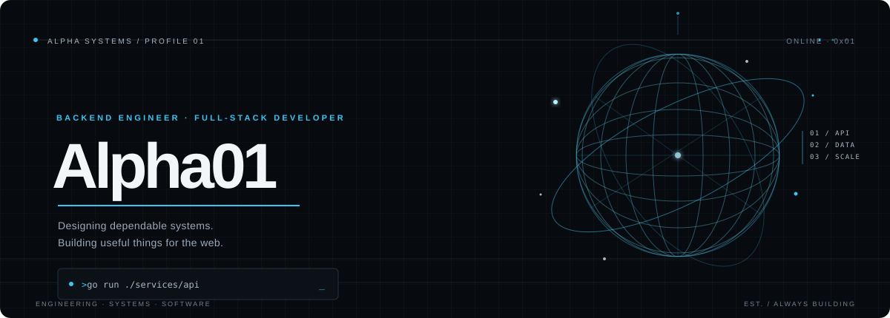
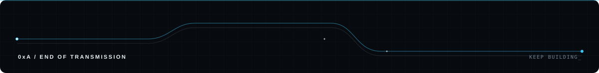

<p align="center">
  
</p>

## About

I build backend systems, REST APIs, and full-stack applications. Currently focused on Go, system design, databases, and scalable software architecture.

```text
IDENTITY  Alpha01 / 0xAlpha01
ROLE      Software Developer · Backend Engineer · Problem Solver
FOCUS     Go · Gin · REST APIs · System Design · Databases · Full-Stack
```

## 🛠️ Skills & Tech Stack
<p align="center">
  
  
  
  
  
  
  <a href="https://vercel.com/">
    
  </a>
  &nbsp;
  <a href="https://render.com/">
    
  </a>
  &nbsp;
  <a href="https://railway.app/">
    
  </a>
</p>
## 📊 GitHub Activity

<p align="center">
  
  
</p>

<p align="center">
  
</p>


<p align="center">
  
</p>
